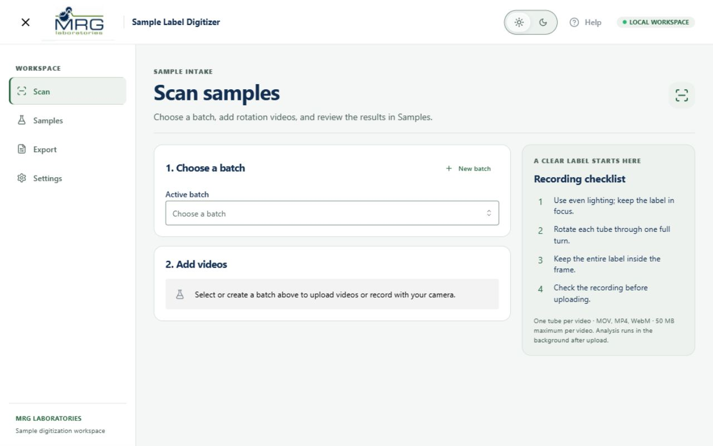
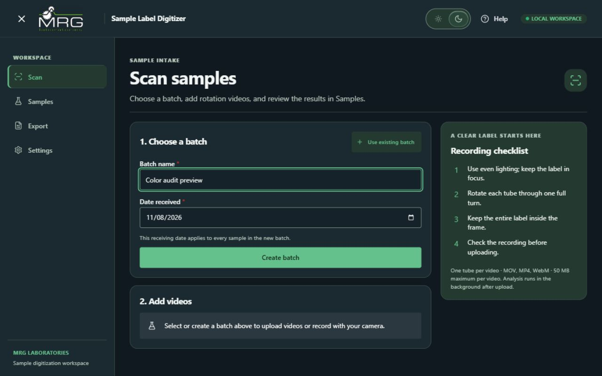
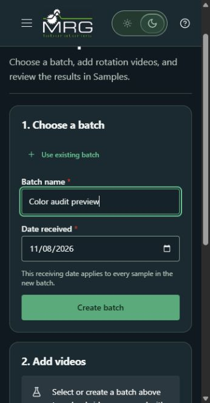

# MRG color and readability audit

Branch: `codex/accessible-color-palette`.
Scope: shared light/dark colors, Scan forms/navigation, review warning tokens,
and narrow-screen header. This is a targeted color review, not a complete WCAG certification.

## Evidence and method

- Inspected the running Scan screen in both themes, including the new-batch form.
- Read computed CSS colors, input placeholders and borders, rather than sampling
  antialiased text pixels. Initial preview served the older Docker frontend; rebuilt
  it from this branch before verifying the revised palette.
- `color-inventory-before.json` records 185 distinct source hex literals in frontend
  CSS/TSX before the new palette, with source file locations. It includes unused
  legacy styles and alpha hex values; it is not a list of simultaneously visible colors.
- `color-contrast.json` contains full-precision sRGB luminance calculations. Reproduce
  with `rtk proxy node scripts/audit-colors.cjs`. Do not rerun `--inventory` to preserve
  the before inventory.
- WCAG AA requires 4.5:1 for normal text and 3:1 for large text. Essential control
  boundaries and state indicators need 3:1 against adjacent colors. Decorative
  card dividers do not automatically require 3:1. Disabled controls are exempt,
  though their labels are kept readable in the new theme.

## Original primary palette (exact hex)

| Role | Light | Dark |
|---|---|---|
| Main background | `#FFFFFF` | `#101820` |
| Secondary surface | `#F3F7F2` | `#1B2930` |
| Main text | `#122E50` | `#F1F5F3` |
| Secondary text | `#53665E` | `#B4C5BA` |
| Primary accent | `#25633E` | `#65C18C` |
| Decorative border | `#D8E2DA` | `#3B514A` |
| Input boundary (computed) | `#CED4DA` | `#4A6258` |
| Input background (computed) | `#FFFFFF` | `#162229` |
| Input placeholder | `#ADB5BD` | `#A6B8AD` |

Additional visible drift: light footer `#12B886`, dark footer `#38D9A9`,
light eyebrow `#5B7C7D`, active light navigation `#EDF4EE`, dark active navigation
`#263E30`, and light recording guide `#F7FAF8`. The main text already had strong
contrast; the problem was inconsistent peripheral styling and controls.

## Composition and the 60–30–10 rule

60–30–10 is a visual hierarchy heuristic, not a WCAG requirement. For this researcher
workspace, neutral canvas and readable work surfaces deserve most of the area.
Forcing saturated green into 10% of the screen would compete with alerts and data.

At 1280×800, sampled the topmost element background on a 10px grid (10,240 points),
walking through transparent parents. This measures background coverage, excluding
text/icon pixel coverage, gradients, and alpha compositing. It is not a precise
photographic/pixel histogram or a measurement of perceived visual weight.

| Light Scan, no selected batch | Before | After |
|---|---:|---:|
| White background/surfaces | 83.13% | 41.02% |
| Off-white canvas `#F5F7F6` | — | 42.13% |
| Sage secondary `#EDF2EF` | — | 13.22% |
| Other pale fills / translucent UI | 16.87% | 3.63% |

The final dark sample has 42.13% deep canvas, 38.24% primary
surfaces, 2.34% dark inputs, 13.62% sage surfaces, and 3.67% other translucent UI.
Strong accent fills are absent in this empty state; green text/icons are not counted
by this background-only method. Populated batches and action buttons change coverage.

Design decision: retain the dominant/secondary/accent hierarchy behind 60–30–10,
but do not claim the measured page literally meets those percentages. The change
replaces one large white field with clearer canvas/card separation, while green
identifies navigation and actions. Warnings/errors retain their own semantic hues.

## Contrast findings and corrections

| Pair | Before | After | Requirement |
|---|---:|---:|---:|
| Light main text / white | 13.70:1 | 13.70:1 | 4.5:1 |
| Light footer accent / white | 2.55:1 FAIL | 7.16:1 | 4.5:1 |
| Light placeholder / white input | 2.07:1 FAIL | 5.54:1 | 4.5:1 |
| Light input border / white | 1.49:1 FAIL | 3.93:1 | 3:1 |
| Dark main text / card | 13.58:1 | 13.58:1 | 4.5:1 |
| Dark input border / input | 2.46:1 FAIL | 5.27:1 | 3:1 |

The new dark boundary also contrasts 4.85:1 against the adjacent card surface.
Replacement primary-button pairs are 7.16:1 light and 7.27:1 dark. Warning text
pairs are 6.53:1 light / 9.29:1 dark; error text pairs are 6.16:1 / 8.43:1.
These are selected token-pair measurements, not proof that every application state passes.

## Revised palette

| Role | Light | Dark |
|---|---|---|
| Canvas | `#F5F7F6` | `#101820` |
| Cards, header, sidebar | `#FFFFFF` | `#1B2930` |
| Secondary / selected surfaces | `#EDF2EF` | `#243A30` |
| Main text | `#122E50` | `#F1F5F3` |
| Secondary text | `#4D6259` | `#B4C5BA` |
| Accent | `#25633E` | `#65C18C` |
| Accent hover | `#1E5133` | `#85D2A5` |
| Text on accent | `#FFFFFF` | `#10261A` |
| Decorative border | `#D6DFDA` | `#3B514A` |
| Control border | `#71857A` | `#82988D` |
| Input | `#FFFFFF` | `#162229` |
| Placeholder | `#596D63` | `#B4C5BA` |
| Warning text / fill | `#76510B` / `#FFF5D6` | `#F5D889` / `#3B3017` |
| Error text / fill | `#A52C35` / `#FDEDEF` | `#FFB4BD` / `#3B252B` |

## Gradient assessment

No generic purple/blue gradient was visible on the current Scan route. Its guide
was already rendered as a solid fill through a later override. The source still
contains layered radial sage/mint/blue welcome backgrounds, including `#D9EDDD`,
`#E0F1EA`, `#FBFCFA`, `#F1F6ED`, `#E7F4EC`, and dark `#304C3B`, `#203D36`,
`#19282A`, `#20332A`, `#233F30`. That legacy welcome route currently redirects to Scan.

Design judgment: those overlapping decorative glows add competing temperature and
surface cues without explaining the laboratory task. Disabled the legacy gradient
layers and supplied solid theme surfaces. This is an aesthetic simplification, not
a claim that gradients inherently violate accessibility. Kept the barcode stripe
pattern because it represents a barcode rather than a decorative gradient.

## Implementation and limits

`frontend/src/palette.css` is loaded after legacy/theme CSS. It centralizes active
surfaces, text, controls, nav selection, focus, warnings and errors. The earlier CSS
is preserved to avoid deleting styles used by legacy components. The footer now
uses the same brand token in both themes. Narrow header groups cannot wrap into
the form; the Help icon keeps its accessible name when its text is hidden.

Verified: contrast calculations, frontend production compilation, rendered Scan
light/dark forms, and narrow header layout. Remaining work for a complete audit:
all populated sample-table states, open menus/modals, high zoom, forced colors,
screen-reader testing, and transient colors during the existing theme animation.
Photos/videos/logos are not recolored. Confidence remains subjective, and review
and data processing behavior is preserved.

References:
[WCAG 2.2 text contrast](https://www.w3.org/WAI/WCAG22/Understanding/contrast-minimum.html),
[WCAG non-text contrast](https://www.w3.org/WAI/WCAG22/Understanding/non-text-contrast.html).

## Rendered evidence

